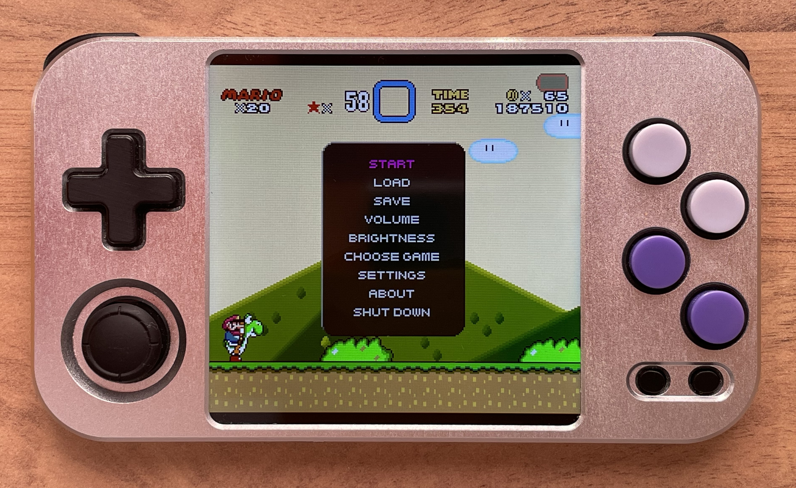

# picoheld2_rp2350_snes9x
This is Snes9x running on the Pico Held 2 (Raspberry Pi RP2350 edition)

It's based on Ducalex's Snes9x port for the Retro-Go project (https://github.com/ducalex/retro-go)

## Overview

It's a Snes emulator running on the RP2350 microcontroller with just 520 KB of internal RAM and 8 MB PSRAM.
It features a UI to configure the emulator, load and save games, and to load ROM files (from SD card into PSRAM).
The target framerate is locked at 50 Hz. However, only a few games can consistently achieve this framerate. For less demanding titles like Super Mario World you get about 30-50 fps. More demanding games might cause framerates of 20 fps and below.

## Building

Build with Pico SDK (I used version 2.1.1).
You can find a prebuilt version in the artifacts directory.

## Structure

The subdirectories are as follows:

### emmugr
emulator manager - everything related to the emulator like loading/saving and parts of the HAL (TODO: tidy up :) )

### pico_fatfs
FatFS implementation (see credits below)

### picoengine
The actucal hardware engine handling all hardware stuff like LCD driver, sound, input power managment and so on (see https://github.com/fcipaq/picoengine)

### snes9x
Well... Snes9x :)

### sparkfun_pico

PSRAM driver (see credits below)

## Credits

Special thanks go all Snes9x collaborators (Snes9x), Ducalex (port to MCU), Sparkfun (PSRAM driver), the FatFS team (https://elm-chan.org/fsw/ff/) and Elehobica (Pico FatFS, https://github.com/elehobica/pico_fatfs)

Enjoy! :)